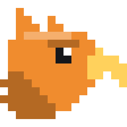

# Griff

**A game engine for game jams.** Griff is a 2D-first engine and editor (built so 3D can follow), written in C#. It aims to be the shortest path from an idea to something people can play by Sunday night, with an editor that just works.

Its website is [griff.games](https://griff.games), and it's open source under the [MIT License](LICENSE).

## Documentation

The docs are on the website, [griff.games](https://griff.games), and live in this repository in [`site/src/content/docs`](site/src/content/docs):

- [What is Griff](https://griff.games/docs/what-is-griff/): the promises it is built around (the game keeps running while you change it, rewind, undo for everything, readable files...) and what it comes with.
- [Getting started](https://griff.games/docs/getting-started/): the editor, a first project, playing and shipping it.
- Guides: [the editor](https://griff.games/docs/editor/), [scenes and components](https://griff.games/docs/scenes-and-components/), [scripting](https://griff.games/docs/scripting/), [multiplayer](https://griff.games/docs/multiplayer/), [exporting](https://griff.games/docs/exporting/) (desktop and web), [text and fonts](https://griff.games/docs/text-and-fonts/) and [agents (MCP)](https://griff.games/docs/agents/).
- Reference, written from the code when the site is built: [every component](https://griff.games/reference/components/), [every editor command](https://griff.games/reference/commands/) and [the scripting API](https://griff.games/reference/api/).
- [Architecture](https://griff.games/docs/architecture/), [building Griff](https://griff.games/docs/building/) and [known gaps](https://griff.games/docs/status/).

## Building

Requires the .NET 10 SDK on Windows.

```
dotnet build
dotnet test
dotnet run --project src/Griff.Editor
```

`dotnet build src/Griff.Editor/Griff.Editor.csproj` builds the editor and publishes the game players it exports games with; the tests are `tests/Griff.Tests` and `tests/Griff.Editor.Tests`. The rest is in [building Griff](site/src/content/docs/docs/building.md), and the website (`site/`) in [site/README.md](site/README.md).

## License

Griff is open source under the [MIT License](LICENSE), Copyright (c) 2026 Shawn Rakowski. The packages it builds on keep their own licenses, and so do the fonts it bundles, each with its license text beside it: the fonts games are drawn with (whose licenses every export writes into `THIRD-PARTY-NOTICES.txt`), and JetBrains Mono, the font the editor's code and the website's wordmark are set in, under the SIL Open Font License (`src/Griff.Editor/Themes/Fonts`, `site/public/fonts`).

